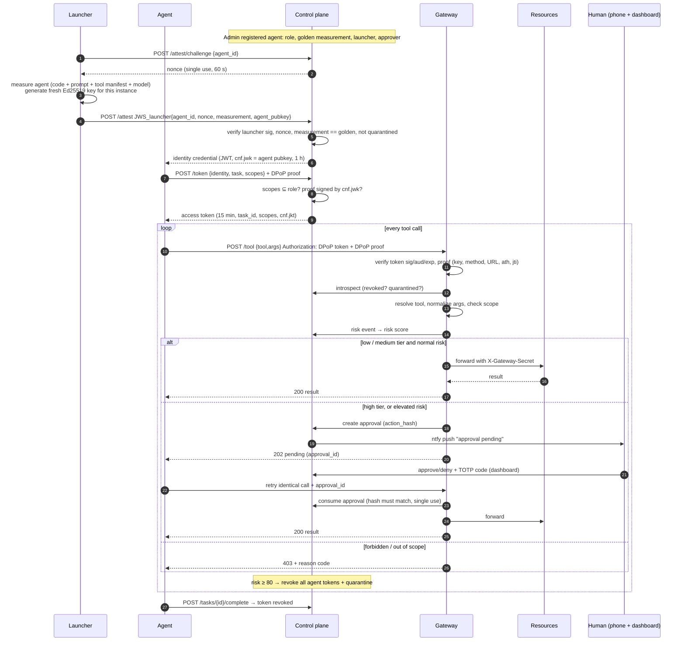

# AIMFA Architecture

For a plain-English version, read [LEARNING.md](LEARNING.md) first. Endpoint-level detail lives in [CONTRACTS.md](CONTRACTS.md).

## Design principles
1. **Zero trust (NIST SP 800-207).** Every request is checked, every time. Being "inside" (holding a token) grants nothing on its own.
2. **One enforcement point.** Agents can reach resources **only** through the gateway, the Policy Enforcement Point (PEP). Resources reject anything that doesn't carry the gateway's secret.
3. **Independent factors.** Breaking one layer (e.g. stealing a token) doesn't break the others (e.g. the private key, scope, behavior, or the human).
4. **Least privilege, short lifetime.** Each token covers one task and only the scopes it needs, and lasts 15 minutes. It is revoked when the task ends.
5. **Fail closed and audit everything.** Any error means deny. Every decision is written to a tamper-evident log.

## Components
| Component | Port | Role in zero-trust terms | Key modules |
|---|---|---|---|
| **Control plane** | 8000 | Policy Decision Point + identity provider | `registry`, `attestation`, `sts`, `revocation`, `monitor`, `approvals`, `notify`, `audit` |
| **Gateway** | 8100 | Policy Enforcement Point | `pipeline` (the checks), `proxy` (tool → resource), `baseline` (weak mode) |
| **Mock resources** | 8200 | Protected resources (fake files, email, bank, db) | `app`, `seed_data/` |
| **Launcher** | – | Root of trust that measures agents (stand-in for a SPIRE agent / TPM) | `agents/launcher.py` |
| **Agents** | – | Workloads being protected: scripted or TAMU AI | `agents/client.py`, `scripted/`, `llm_agent.py` |
| **Dashboard** | 8501 | Admin + human-approver console + attack lab | `dashboard/` |

**Shared library `aimfa/common`:**
- `models.py`: the contracts
- `crypto.py`: keys, JWT, thumbprints, measurement
- `dpop.py`: proof create/verify + replay cache
- `policy.py`: scope matching and tiers
- `db.py`: SQLite
- `config.py`: settings

## Lifecycle of an agent task

## Trust boundaries
| Boundary | Between | Protection |
|---|---|---|
| **TB1** | Agent ↔ gateway / control plane | The agent is **untrusted**: it might be injected or hijacked. Protected by DPoP-bound tokens, scope, the monitor and human step-up. |
| **TB2** | Gateway ↔ resources | Only the gateway knows `GATEWAY_RESOURCE_SECRET`. Resources also re-validate paths (defense in depth). |
| **TB3** | Gateway ↔ control plane internal API | `INTERNAL_SERVICE_SECRET` |
| **TB4** | Admin / dashboard ↔ control plane | `ADMIN_API_KEY`. Approvals additionally need the human's TOTP. |
| **TB5** | Launcher ↔ control plane | The launcher's Ed25519 signature on the evidence. **The launcher is trusted** (see ADR-0003). |

## Data stores
**SQLite** at `var/aimfa.db`, owned by the control plane. Tables:
- `launchers`, `agents`, `approvers`
- `nonces`, `tokens`
- `approvals`, `risk_events`
- `audit`

**Other state:**
- **Keys:** the control-plane signing key and the launcher key live in `keys/`, git-ignored. Agent instance keys are **memory only**.
- **Mock data:** `var/resources/` (copied from `seed_data/` on reset) and `var/outbox.jsonl` (sent emails).
- **Gateway:** the DPoP replay cache is in memory. Gateway restarts are acceptable, because proofs older than 60 s are rejected anyway.

## Modes
| Mode | Gateway behavior |
|---|---|
| `aimfa` (default) | Full pipeline above |
| `baseline` | Gateway checks only a static `X-API-Key` and forwards. This represents today's common practice, and attacks are compared against it. |

## Policy model
- **`policy/roles.yaml`:** for each role, its `allowed_scopes` (what the STS may grant), its `profile` (which resource categories are normal for it, used by the monitor), and a rate limit.
- **`policy/actions.yaml`:** for each tool, its scope family, which argument becomes the scope target, and its tier. Also defines the resource categories and which resources count as sensitive.
- **Scope string:** `service:verb:target`. Wildcards are `*`, matched against the **normalized** path.
